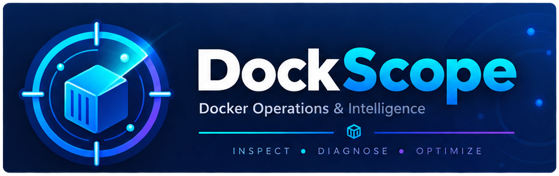
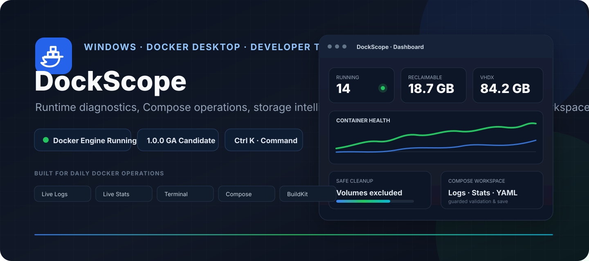
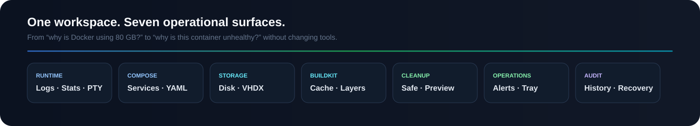
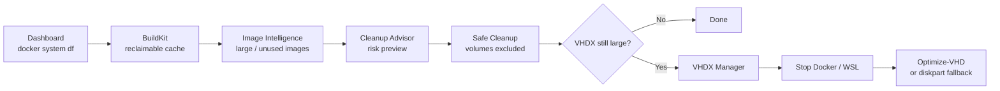
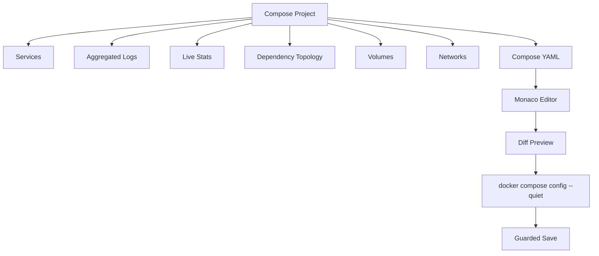
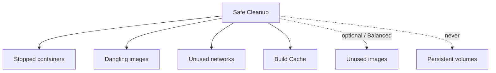
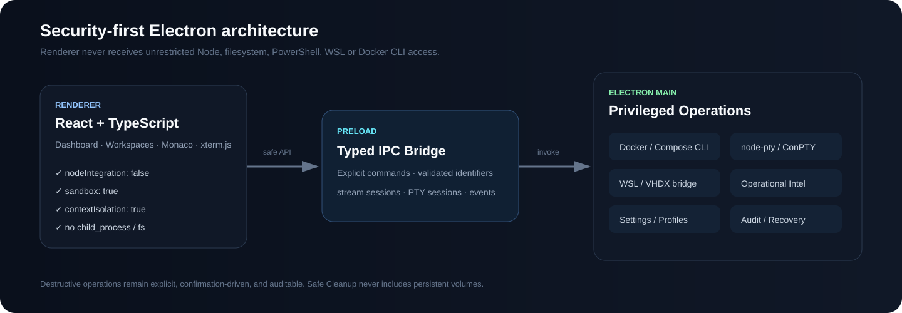
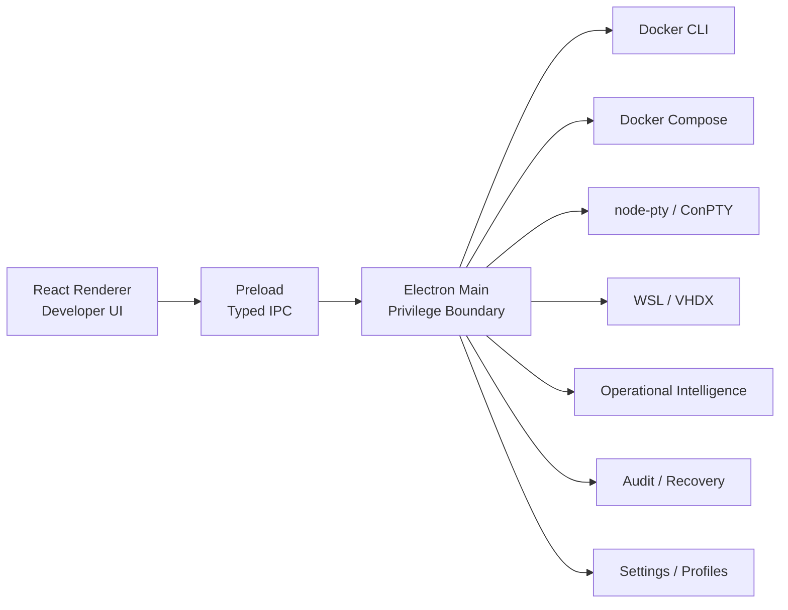

<p align="center"></p>

<p align="center">
  
</p>

<p align="center">
  
  
  
  
  
  
  
  <a href="https://github.com/betisa/DockScope/actions/workflows/ci.yml"></a>
  <a href="https://github.com/betisa/DockScope/releases"></a>
  <a href="https://github.com/betisa/DockScope/issues"></a>
</p>

<p align="center">
  <strong>A security-first Docker Desktop companion for Windows.</strong><br>
  Diagnose containers, operate Compose stacks, understand disk usage, inspect BuildKit and image layers, reclaim space safely, monitor health, and audit destructive actions — without turning the Renderer into a privileged shell.
</p>

<p align="center">
  <a href="./docs/USER-GUIDE.md"><strong>User Guide</strong></a>
  ·
  <a href="./docs/FEATURE-MATRIX.md">Feature Matrix</a>
  ·
  <a href="./docs/SECURITY-REVIEW.md">Security</a>
  ·
  <a href="./docs/GA-RELEASE-CHECKLIST.md">GA Checklist</a>
  ·
  <a href="./CHANGELOG.md">Changelog</a>
  ·
  <a href="./CONTRIBUTING.md">Contributing</a>
  ·
  <a href="./SECURITY.md">Security Policy</a>
</p>

---

<p align="center">
  
</p>

## Why DockScope?

Docker Desktop already gives you the engine. DockScope focuses on the operational questions that tend to require multiple terminals, commands, and Windows tools:

- **Why is Docker using so much disk space?**
- **Which cache or image is safe to reclaim?**
- **Why is this container unhealthy or restarting?**
- **Which Compose service owns this port, volume, or network?**
- **Can I edit this Compose file without silently overwriting external changes?**
- **Why is `docker_data.vhdx` still huge after cleanup?**
- **What exactly did I delete, and what metadata would I need to recreate it?**

The app combines runtime diagnostics, storage analysis, Compose operations, BuildKit intelligence, safe cleanup, notifications, audit history, and Windows VHDX workflows in one developer-oriented desktop UI.

---

## Dashboard charts

The overview now visualizes real Docker state rather than static demo data:

- storage footprint vs reclaimable space from `docker system df`;
- container state distribution from the current container inventory;
- direct shortcuts from runtime counts into Containers and Notifications.

The chart layer is implemented with lightweight responsive SVG/CSS components, so no additional charting framework is added to the GA bundle.

## Resource list ergonomics

Resource-heavy views now share a consistent **search + 10-item pagination** pattern, while the Containers inventory keeps its dedicated large-list optimization. Volume inventory also displays Docker-reported **Created At** and **Size** metadata.

The custom Windows title bar includes an explicit drag surface, and resource navigation uses purpose-specific Hugeicons for Containers, Compose, Images, BuildKit, Volumes and Networks.

## Contextual in-app guides

Every top-level page includes a **Guide** button in its header. The guide opens inside the application as a keyboard-accessible drawer with page-specific workflows, safety notes, and shortcuts — no external documentation lookup required for routine tasks.

See **[In-App Page Guides](./docs/IN-APP-PAGE-GUIDES.md)** for the coverage matrix.

## Highlights

| Area | What you get |
|---|---|
| **Runtime & Diagnostics** | Live logs, live stats, health history, processes, ports, mounts, networks, environment inspection, raw inspect, xterm.js terminal |
| **Compose Workspace** | Project/service operations, aggregated logs, stats, topology, networks, volumes, environment, Monaco YAML editor, validation and guarded save |
| **Storage Intelligence** | `docker system df`, Docker VHDX discovery, host drive context, cleanup guidance |
| **BuildKit & Images** | Buildx builders, cache usage, reclaimable cache, image history, large-layer detection, optimization hints |
| **Safe Cleanup** | Risk-classified advisor, preview-oriented workflows, Safe/Balanced modes, **volumes excluded from Safe Cleanup** |
| **Operational Intelligence** | Unhealthy/exit/restart-loop detection, VHDX/build-cache thresholds, Notification Center, Windows notifications, System Tray |
| **Audit & Recovery** | Persistent action history, pre-delete metadata snapshots, JSON export, masked secret values |
| **Productivity** | `Ctrl+K` Command Palette, fuzzy resource search, recent resources, favorites, quick actions |
| **Profiles & Settings** | Development, Conservative, CI/Build Heavy, Low Disk Space, Custom; Docker context, cleanup, terminal, monitoring, storage and security policy |
| **GA Hardening** | Lazy loading, virtualization, buffered streams, ErrorBoundary, accessibility pass, bundle budgets, Windows E2E packaging gates |

---

## Quick start

### Requirements

- Windows 10 or Windows 11
- Docker Desktop
- Docker CLI / Docker Compose
- WSL2 backend recommended
- Node.js 22+ only when running from source

Verify Docker first:

```powershell
docker version
docker context show
docker compose version
```

### Run from source

```powershell
npm install
npm run typecheck
npm run dev
```

### Build

```powershell
npm run build
```

### Package for Windows

```powershell
npm run package:win
```

This produces Windows targets configured for:

- **NSIS installer**
- **Portable executable**

> Public distribution should use a real Windows code-signing certificate. The repository intentionally does not include fake signing credentials.

For detailed first-run and task-oriented instructions, read the **[User Guide](./docs/USER-GUIDE.md)**.

---

## A typical disk-recovery workflow



**Important:** deleting Docker objects and shrinking the Windows VHDX file are different operations. Reclaim Docker space first; compact the virtual disk afterward only when necessary.

---

## Container Diagnostics Advisor

Every Container Workspace now opens with an **Advisor** tab that correlates Docker inspect state, health checks, the last 400 log lines, and a point-in-time Docker Stats sample. Findings are rule-based and evidence-driven: each card separates **Symptom → Evidence → Likely Cause → Recommended Actions**.

Current rules cover OOMKilled, exit 137/non-zero exits, repeated restarts, unhealthy health checks, port conflicts, permission failures, ENOSPC, DNS/connection failures, missing configuration patterns, and high CPU/memory pressure. The advisor is read-only and does not auto-remediate containers.

See **[P13.02 — Container Diagnostics Advisor](./docs/P13.02-CONTAINER-DIAGNOSTICS-ADVISOR.md)**.

## Runtime diagnostics

Select a container and open a dedicated workspace with:

```text
Overview
Logs
Stats
Processes
Health
Ports
Mounts
Networks
Environment
Inspect
Terminal
```

### Live Logs

- `docker logs --follow`
- text and regex filtering
- pause / resume
- auto-scroll
- bounded retention
- buffered Renderer updates for high-throughput streams
- `Esc` to stop supported streams

### Interactive terminal

The terminal uses:

```text
Renderer: xterm.js
        ↓
Typed IPC
        ↓
Electron Main
        ↓
node-pty / ConPTY
        ↓
docker exec -it
```

Supported shell preferences include:

```text
auto
bash
sh
pwsh
powershell
cmd
```

---

## Compose Workspace

The Compose area is project-centric rather than a flat command list.



The editor avoids silent overwrite:

1. edit YAML;
2. inspect the diff;
3. validate with Docker Compose;
4. verify the file was not modified externally;
5. create `.dsm.bak`;
6. save;
7. redeploy only if you choose to.

`Down + Volumes` stays outside normal convenience workflows because persistent data deserves a separate risk boundary.

---

## Build Diagnostics Workspace

Build History is now actionable: select **Diagnostics** on any Buildx record to open a modal with **Overview, Logs, Steps, Cache, Timing, and Error Analysis**. The workspace uses real `docker buildx history inspect/logs` data and can open the selected record in Docker Desktop. Error Analysis is rule-based and only reports causes when matching evidence exists in the actual build logs.

## BuildKit and Image Intelligence

### BuildKit

Inspect:

- Buildx builders
- driver/status/platforms
- Build Cache records
- reclaimable cache
- safe cache prune
- full unused-cache prune

### Image Intelligence

Use Docker image history to identify:

- largest layers
- layers ≥ 100 MB
- very large layers ≥ 500 MB
- package-manager cache opportunities
- JavaScript dependency caching patterns
- `.NET` multi-stage build opportunities

The advisor is intentionally heuristic: it explains likely optimization opportunities but does not rewrite Dockerfiles automatically.

---

## Safe Cleanup

Cleanup recommendations are risk-classified.

| Candidate | Typical risk |
|---|---|
| Stopped containers | Low |
| Dangling images | Low |
| Unused networks | Low |
| Build Cache | Low |
| All unused images | Medium |
| Unused volumes | High |

Safe Cleanup intentionally follows this model:



> **Persistent volumes are never silently folded into Safe Cleanup.**

---

## VHDX Manager

Docker Desktop on WSL2 can leave `docker_data.vhdx` physically large even after Docker objects are removed.

The app can:

- discover common Docker Desktop VHDX paths;
- use a custom VHDX path from Settings;
- report file size and host-drive context;
- guide a disruptive compaction workflow;
- try `Optimize-VHD -Mode Full`;
- fall back to `diskpart compact vdisk`.

Compaction sequence:

```text
Docker Desktop stop attempt
        ↓
wsl --shutdown
        ↓
Optimize-VHD -Mode Full
        ↓
diskpart fallback when required
```

Run the packaged app as Administrator when Windows permissions require elevation.

---

## Operational Intelligence

Background monitoring runs in Electron Main so it can survive a hidden main window.

It can detect:

- Docker Engine disconnect
- container becoming unhealthy
- unexpected container exit
- possible restart loop
- large Docker VHDX
- large reclaimable Build Cache

Monitoring is **read-only**. It never runs cleanup or VHDX compaction automatically.

The System Tray provides status and shortcuts while the application continues monitoring.

---

## Command Palette

Press:

```text
Ctrl + K
```

or:

```text
Ctrl + Shift + P
```

Then search pages, containers, Compose projects, images, or safe actions.

Examples:

```text
restart api
logs postgres
my-compose-project
postgres:18
safe cleanup
build cache
notifications
```

Keyboard behavior:

| Key | Action |
|---|---|
| `↑` / `↓` | Navigate |
| `Enter` | Open / execute |
| `Esc` | Close |
| `Pin` | Favorite |

The palette traps keyboard focus while open and restores the previous focus target when closed.

---

## Audit & Recovery Metadata

Before supported destructive operations, the app can preserve metadata that helps explain or recreate the resource later.

Examples:

**Container snapshot**

```text
Image
Command / Entrypoint
Working directory
Restart policy
Ports
Mounts
Networks
Labels
Health
Masked environment
```

**Compose snapshot**

```text
Services
Networks
Volumes
Config files
```

**Volume snapshot**

```text
docker volume inspect metadata
```

> Recovery Metadata is **not a backup**. Deleted volume contents, database files, object-storage data, and deleted image layers are not restored from metadata alone.

Audit history can be exported as JSON.

---

## Profiles

| Profile | Best for | Behavior |
|---|---|---|
| **Development** | Normal local development | Balanced monitoring and cleanup defaults |
| **Conservative** | Maximum caution | Slower monitoring, more cache retention, Force Remove disabled |
| **CI / Build Heavy** | Frequent builds | Higher cache thresholds and larger log/cache retention |
| **Low Disk Space** | Storage pressure | Lower alerts, Balanced cleanup defaults, unused images included |
| **Custom** | Fine tuning | Automatically activated after manual changes |

No profile enables automatic persistent-volume deletion.

---

## Contributing & development workflow

DockScope uses **Conventional Commits** and a lightweight **Git Flow**:

```text
feature/* ─┐
fix/* ─────┼─> develop ─> release/* ─> main ─> vX.Y.Z
docs/* ────┘                         ↑
                               hotfix/*
```

Start here:

- **[CONTRIBUTING.md](./CONTRIBUTING.md)** — development, PR and testing rules
- **[Git Workflow](./docs/GIT-WORKFLOW.md)** — branches, commits, release/hotfix flow
- **[Release Process](./docs/RELEASE-PROCESS.md)** — Stable/Preview releases and updater
- **[GitHub Setup](./docs/GITHUB-SETUP.md)** — repository rulesets, Actions and secrets
- **[Security Policy](./SECURITY.md)** — responsible vulnerability reporting

Enable the local Conventional Commit hook after cloning:

```powershell
npm run git:setup
```

## GitHub Releases & automatic updates

Installed NSIS builds update directly from **GitHub Releases**. Stable maps to the `latest` channel; Preview maps to `beta`. Release assets and updater metadata are created by GitHub Actions from version tags.

Stable:

```text
1.2.0 → v1.2.0 → GitHub Release → latest
```

Preview:

```text
1.3.0-beta.1 → v1.3.0-beta.1 → GitHub Prerelease → beta
```

The application does not accept an arbitrary updater URL from the Renderer. The GitHub provider is embedded by `electron-builder` into the packaged app.

## Security architecture

<p align="center">
  
</p>

The core rule is simple:

> **The Renderer is a UI, not a privileged shell.**

### Renderer

- `nodeIntegration: false`
- `contextIsolation: true`
- `sandbox: true`
- no unrestricted filesystem
- no direct `child_process`
- no direct PowerShell / WSL / Docker CLI

### Preload

- narrow typed API
- explicit IPC channels
- session-based streams and PTY bridges

### Electron Main

Owns:

- Docker CLI
- Docker Compose
- WSL / VHDX operations
- node-pty
- monitoring
- audit
- settings persistence
- privileged file operations

See **[Security Review](./docs/SECURITY-REVIEW.md)** for the GA checklist.

---

## Architecture flow



---

## Application identity

DockScope ships with a project-native Windows icon used consistently by the installed executable, NSIS installer/uninstaller, desktop and Start Menu shortcuts, application window, native Windows identity, and System Tray.

The editable source and packaging details are documented in **[APP-ICON.md](./docs/APP-ICON.md)**.

## Technology

| Layer | Technology |
|---|---|
| Desktop shell | Electron 43 |
| Renderer | React 19 + TypeScript |
| Build tooling | electron-vite 5 + Vite 7 |
| Terminal | xterm.js + node-pty |
| Compose editor | Monaco Editor |
| Icons | Hugeicons React |
| Tests | Vitest + React Testing Library |
| E2E | Playwright Electron |
| Windows packaging | electron-builder / NSIS / Portable |

UI conventions follow a developer-tool/IDE direction, with accessibility and resilience reviewed using the current **UI UX Pro Max** guidance. Icons are centralized through an app-level Hugeicons wrapper for consistent color, stroke, tree shaking, and assistive-technology behavior.

---

## Testing and GA verification

### Unit / integration

```powershell
npm run test
npm run test:coverage
```

The repository includes a deterministic Mock Docker CLI so integration tests can exercise the real process boundary without modifying your actual Docker Desktop state.

Supported mock scenarios include:

```text
success
failure
daemon-down
timeout
```

### Electron E2E

```powershell
npm run test:e2e
```

### GA bundle budgets

```powershell
npm run ga:budget
```

Current output budgets:

| Surface | Budget |
|---|---:|
| Renderer | 14 MiB |
| Main | 5 MiB |
| Preload | 3 MiB |

### Full GA gate

```powershell
npm run ga:verify
```

### Verify and package

```powershell
npm run ga:package
```

The complete release procedure is documented in **[GA-RELEASE-CHECKLIST.md](./docs/GA-RELEASE-CHECKLIST.md)**.

---

## Development structure

```text
src/
├── main/
│   ├── monitoring/
│   └── services/
├── preload/
├── renderer/
│   └── src/
│       ├── components/
│       ├── hooks/
│       ├── pages/
│       └── productivity/
└── shared/

tests/
├── mock/
├── unit/
├── integration/
├── renderer/
└── e2e/

docs/
├── USER-GUIDE.md
├── SECURITY-REVIEW.md
├── TEST-STRATEGY.md
├── ACCESSIBILITY-REVIEW.md
├── PERFORMANCE-BUDGET.md
└── GA-RELEASE-CHECKLIST.md
```

---

## Documentation

| Document | Purpose |
|---|---|
| **[User Guide](./docs/USER-GUIDE.md)** | Complete task-oriented usage guide |
| [Feature Matrix](./docs/FEATURE-MATRIX.md) | Implemented product capabilities |
| [Security Review](./docs/SECURITY-REVIEW.md) | Electron security and packaging review |
| [Test Strategy](./docs/TEST-STRATEGY.md) | Unit, integration, renderer, and Electron E2E strategy |
| [Accessibility Review](./docs/ACCESSIBILITY-REVIEW.md) | Keyboard, semantics, visual resilience |
| [Performance Budget](./docs/PERFORMANCE-BUDGET.md) | GA performance and memory budgets |
| [GA Release Checklist](./docs/GA-RELEASE-CHECKLIST.md) | Final Windows release acceptance |
| [GA Release Notes](./docs/GA-RELEASE-NOTES.md) | 1.0 release summary |
| [Dependency Baseline](./docs/DEPENDENCY-BASELINE-GA.md) | GA package/toolchain baseline |
| [Changelog](./CHANGELOG.md) | Version history |

Milestone-specific implementation notes remain under `docs/M04-*` through `docs/M12-*`.

---

## Known GA requirements

The source is a **1.1.0 Release Candidate**. Before publishing public Windows binaries:

1. generate and commit an approved `package-lock.json`;
2. use `npm ci` in release CI after the lockfile is committed;
3. run the full Windows 11 + Docker Desktop acceptance checklist;
4. configure a real Windows code-signing certificate;
5. verify Authenticode on the final NSIS and Portable binaries;
6. publish SHA-256 checksums with release artifacts.

No signing credentials or publisher identity are fabricated in this repository.

---

## Safety notes

Before using destructive operations:

- back up important database and volume data;
- remember that Recovery Metadata is not a data backup;
- review Compose volumes before `down --volumes`;
- use Safe Cleanup before aggressive cleanup;
- close critical WSL/Docker workloads before VHDX compaction.

---

## License

MIT — see the license field in `package.json`.

---

<p align="center">
  <sub>
    README visual direction follows the project-native SVG + searchable Markdown approach popularized by
    <a href="https://github.com/oil-oil/beautify-github-readme">beautify-github-readme</a>.
  </sub>
</p>

### AI-assisted Build Error Analysis

BuildKit Diagnostics → Error Analysis can now request an optional OpenAI-compatible AI second opinion. Provider settings live under Settings → AI Provider; API keys are encrypted with Electron safeStorage and persisted as encrypted data in SQLite. See `docs/BUILDKIT-AI-ERROR-ANALYSIS.md`.

### Container AI Failure Analysis

Container Workspace → Advisor now offers an explicit OpenAI-compatible AI second opinion for stopped/failed containers, unhealthy healthchecks, restart/OOM evidence, and configured-but-unavailable health status. It reuses Settings → AI Provider, redacts and bounds evidence in Electron Main, and keeps deterministic local findings visible. See `docs/CONTAINER-AI-FAILURE-ANALYSIS.md`.
