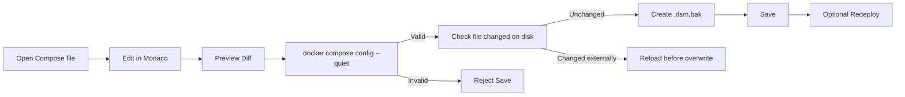
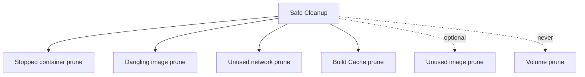
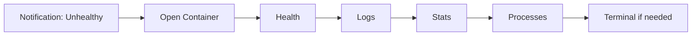
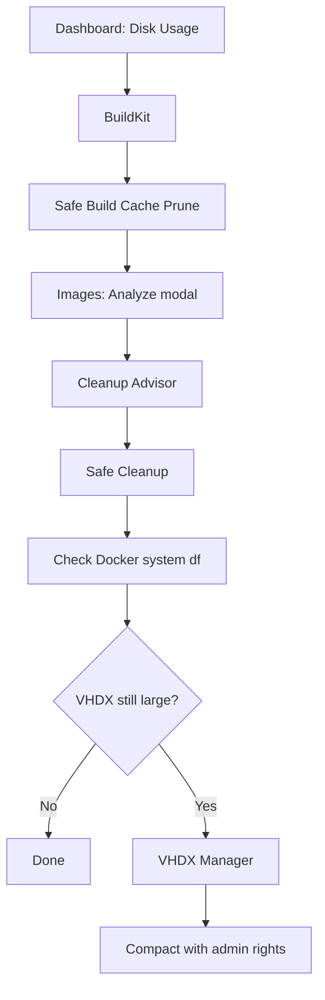

# DockScope Desktop — User Guide

## In-app contextual help

Every top-level page has a **Guide** button beside its title. It opens a contextual guide inside the current page, so you can review workflows, safety notes, and shortcuts without leaving your current Docker workspace. See [In-App Page Guides](./IN-APP-PAGE-GUIDES.md).


> Version: **1.0.0 GA Candidate**  
> Platform: **Windows 10/11 + Docker Desktop**  
> Scope: Runtime diagnostics, Compose operations, storage intelligence, cleanup, monitoring, audit, and VHDX management.

## Table of contents

- [1. Before you start](#1-before-you-start)
- [2. First launch](#2-first-launch)
- [3. Dashboard](#3-dashboard)
- [4. Containers and Runtime Diagnostics](#4-containers-and-runtime-diagnostics)
- [5. Compose Workspace](#5-compose-workspace)
- [6. Images and Image Intelligence](#6-images-and-image-intelligence)
- [7. BuildKit and Build Cache](#7-buildkit-and-build-cache)
- [8. Volumes and Networks](#8-volumes-and-networks)
- [9. Cleanup Advisor](#9-cleanup-advisor)
- [10. VHDX Manager](#10-vhdx-manager)
- [11. Notifications and Operational Intelligence](#11-notifications-and-operational-intelligence)
- [12. Command Palette and Productivity](#12-command-palette-and-productivity)
- [13. Audit and Recovery Metadata](#13-audit-and-recovery-metadata)
- [14. Settings and Profiles](#14-settings-and-profiles)
- [15. Keyboard shortcuts](#15-keyboard-shortcuts)
- [16. Common workflows](#16-common-workflows)
- [17. Safety model](#17-safety-model)
- [18. Troubleshooting](#18-troubleshooting)

---

## 1. Before you start

### Requirements

You need:

- Windows 10 or Windows 11.
- Docker Desktop installed.
- Docker Desktop configured for the WSL2 backend.
- Docker CLI available, or a custom Docker CLI path configured in **Settings → Docker**.
- Administrator rights only for operations that need Windows-level VHDX compaction.
- Node.js 22+ only when running the application from source.

### Verify Docker before launching

Open PowerShell and run:

```powershell
docker version
docker context show
docker compose version
```

A normal Docker Desktop context is usually:

```text
desktop-linux
```

If Docker Desktop is not running, DockScope should still open. The UI will report **Docker Engine Unavailable** instead of terminating.

---

## 2. First launch

When the application opens:

1. Check the Docker Engine status in the top-right status pill.
2. Open **Dashboard** and confirm Docker version, Compose version, and current context.
3. Open **Settings → Docker** if you use a non-default Docker CLI or context.
4. Choose a profile under **Settings & Profiles**.
5. Review **Notifications** thresholds if your Docker data disk is already large.

Recommended first profile:

| Use case | Profile |
|---|---|
| Normal local development | **Development** |
| Prefer safer, less aggressive defaults | **Conservative** |
| Frequent image/build workloads | **CI / Build Heavy** |
| Disk pressure is the main problem | **Low Disk Space** |

Changing any individual profile value automatically switches the active profile to **Custom**.

---

### Search and pagination

Static resource lists use a consistent list toolbar:

- local text search;
- 10 items per page;
- Previous / Next navigation;
- current page and item range.

This behavior applies to Compose projects and service/model lists, Images / Image Intelligence modal/layers, BuildKit builders/history/cache, Volumes, Networks, Notifications, Audit/Recovery, Productivity history, and Docker Activity. The primary Containers list remains optimized separately for large inventories.

## 3. Dashboard

The Dashboard gives a compact view of Docker Desktop health and disk usage.

Typical information includes:

- Docker Engine availability.
- Docker Server version.
- Docker Compose version.
- Active Docker context.
- Image storage.
- Container storage.
- Local volume storage.
- Build Cache.
- Reclaimable space.

### Dashboard charts

The Dashboard includes two live charts sourced directly from Docker:

- **Allocated vs reclaimable** — compares Docker storage categories and highlights reclaimable space within each category.
- **Container states** — a donut view of Running, Restarting, Paused, Stopped, and Other container states.

The container chart also exposes quick counters for Running, Stopped, and Unhealthy resources so you can jump directly into investigation.

### What to look for

If **Build Cache** is the largest reclaimable category, use **BuildKit** before running broad cleanup.

If **Images** dominate storage, open **Images** and choose **Analyze** on large images to inspect Image Intelligence before deciding what to remove.

If Docker's reported usage looks small but `docker_data.vhdx` is very large, use **VHDX Manager** after cleanup.

---

## 4. Containers and Runtime Diagnostics

Open **Containers** to see all containers, including stopped containers.

Available lifecycle operations include:

- Start.
- Stop.
- Restart.
- Remove, with confirmation.

Select a container to open its Runtime Workspace.

### Runtime Workspace tabs

#### Overview

Use this tab for the high-level state and inspect-derived metadata.

#### Logs

Live Logs uses:

```text
docker logs --follow
```

Features include:

- Live streaming.
- Pause / Resume.
- Text search.
- Regex search.
- Auto-scroll.
- Clear.
- Bounded log retention.
- `Esc` to stop the stream.

High-volume logs are buffered before React rendering to reduce UI churn.

#### Stats

Shows live runtime information such as:

- CPU usage.
- Memory usage.
- Network I/O.
- Block I/O.
- PID count.

Stats history is bounded to prevent an endlessly growing client-side dataset.

#### Processes

Displays the container process list using Docker process inspection.

#### Health

When a container defines a health check, the app shows:

- Current health status.
- Failing streak.
- Health command.
- Recent health-check output.

#### Ports

Displays host-to-container mappings.

Use this view when you need to answer questions such as:

```text
Which host port exposes port 8080 from this container?
```

#### Mounts

Shows bind mounts and Docker volumes used by the selected container.

Before removing a container, check this tab if it owns important local or persistent data.

#### Networks

Shows container network connections, including available address and alias information.

#### Environment

Environment values are displayed with secret-like values masked by default.

Common masked names include:

```text
PASSWORD
SECRET
TOKEN
KEY
API_KEY
CONNECTION
CREDENTIAL
```

Do not disable secret masking unless you explicitly need to inspect values on your own trusted machine.

#### Inspect

Displays raw Docker inspect metadata.

#### Terminal

The integrated terminal uses:

- xterm.js in the Renderer.
- node-pty in Electron Main.
- ConPTY on Windows.

Supported shell preferences include:

```text
auto
bash
sh
pwsh
powershell
cmd
```

A shell must exist inside the target container.

---

## 5. Compose Workspace

Open **Compose** and select a Compose project.

The workspace contains:

- Overview.
- Services.
- Logs.
- Stats.
- Topology.
- Volumes.
- Networks.
- Compose.
- Environment.

### Project operations

Available operations include:

```text
Pull
Build
Up
Up + Build
Start
Stop
Restart
Down
```

`Down + Volumes` is intentionally not treated as a normal convenience action because it can delete persistent data.

### Services

Each Compose service can be controlled independently.

Typical service actions:

- Start.
- Stop.
- Restart.
- Open logs.
- Inspect health and published ports.

### Aggregated Logs

Select one or more services to filter the Compose log stream.

### Stats

Displays service/container resource usage at the Compose project level.

### Topology

The project model is derived from:

```powershell
docker compose config --format json
```

Relationships such as `depends_on`, networks, and volumes can therefore be visualized from the resolved Compose model.

### Compose YAML Editor

The Compose editor uses Monaco.

Safe edit workflow:



The Renderer does not receive unrestricted filesystem access. File operations remain in Electron Main.

---

## 6. Images and Image Intelligence

### Images

The Images page supports:

- Listing images.
- Removing an image.
- Pruning dangling images.
- Pruning unused images.

Image inventory and layer history use bounded pagination/search to protect Renderer performance.

### Integrated Image Intelligence

Choose **Analyze** on an image row. The Images page keeps the inventory in place and opens a modal containing Docker history and optimization analysis.

The application highlights:

- Image size.
- Layer sizes.
- Largest layer.
- Number of large layers.
- Dockerfile-like commands that created layers.

Heuristics can identify common optimization opportunities such as:

- Large package-manager layers.
- Missing cleanup after `apt-get`, `apk`, `yum`, or `dnf`.
- JavaScript dependency layers.
- `.NET` publish layers that may benefit from multi-stage builds.
- Layers larger than 100 MB or 500 MB.

These are recommendations, not automatic Dockerfile modifications.

---

## 7. BuildKit and Build Cache

Open **BuildKit** for:

- Buildx builder inventory.
- Builder driver/status.
- Platforms.
- Build Cache records.
- Reclaimable cache.
- Safe cache prune.
- Full unused-cache prune.

### Build History

### Buildx history compatibility

Docker Buildx JSON output varies by Docker Desktop / Buildx version. DockScope accepts both the documented PascalCase JSON shape and Docker Desktop NDJSON records such as:

```json
{"cached_steps":11,"completed_at":"...","completed_steps":19,"created_at":"...","name":"","ref":"desktop-linux/desktop-linux/<build-id>","status":"Completed","total_steps":19}
```

Choose **Diagnostics** on a build row to open Overview, Logs, Steps, Cache, Timing, and Error Analysis in a modal. Escape closes the modal and returns focus to the BuildKit page.

The Build History table displays:

- Build ID extracted from `ref` when an explicit ID is absent;
- full Buildx reference;
- name, with an ID-based fallback for empty names;
- status;
- created/completed timestamps;
- duration calculated from timestamps when Buildx does not return a duration field;
- completed/total steps;
- cached/total steps and cache percentage.

The BuildKit page also lists completed Buildx build records from the active builder using:

```powershell
docker buildx history ls --no-trunc --format json
```

The table includes:

- Build ID
- Name
- Status
- Created time
- Completed time
- Duration
- Repository, when provided by Buildx

Use the status filter to quickly isolate failed or completed builds.

### Recommended workflow

1. Enable **Reclaimable only**.
2. Review cache size and recent usage.
3. Use **Safe prune** first.
4. Use **Prune all** only when rebuilding/downloading cache later is acceptable.

Build Cache cleanup never deletes Docker volumes.

---

## 8. Volumes and Networks

### Volumes

### Volume creation time and size

The Volumes page combines two Docker sources:

- `docker volume inspect` → `CreatedAt`;
- `docker system df -v` → per-volume disk size.

This is necessary because Docker volume inspection exposes creation metadata but does not report the volume's disk usage size.

Volumes are treated as high-risk resources.

The app checks whether a volume is referenced by existing containers.

Use extra caution with volumes used by:

- PostgreSQL.
- SQL Server.
- MySQL.
- Redis persistence.
- MinIO.
- Application uploads.
- Any local database or object-storage service.

A Recovery Snapshot stores **metadata only**. It does not back up the actual files in the volume.

### Networks

Networks can be inspected and unused networks can be pruned.

Removing an unused Docker network generally carries much lower data-loss risk than removing a persistent volume, but active dependencies should still be reviewed.

---

## 9. Cleanup Advisor

The Cleanup Advisor classifies cleanup opportunities by risk.

Typical categories:

| Resource | Typical risk |
|---|---|
| Stopped containers | Low |
| Dangling images | Low |
| Unused networks | Low |
| Build Cache | Low |
| All unused images | Medium |
| Unused volumes | High |

### Safe Cleanup

Safe Cleanup intentionally excludes volumes.

Conceptually:



Use **Settings → Cleanup** to choose your default cleanup mode and Build Cache retention preference.

---

## 10. VHDX Manager

Docker Desktop with WSL2 stores Linux filesystem data in a virtual disk.

A common situation is:

```text
Docker cleanup reports reclaimed space
but
docker_data.vhdx remains physically large on Windows
```

The VHDX Manager helps discover and compact that disk.

### Discovery

Common paths are searched, and you can configure a custom VHDX path under:

**Settings → Storage → Custom Docker VHDX Path**

### Compaction workflow

Compaction is disruptive. Save your work first.

The application performs:

1. Attempt to stop Docker Desktop.
2. Run:

```powershell
wsl --shutdown
```

3. Try PowerShell:

```powershell
Optimize-VHD -Mode Full
```

4. Fall back to:

```text
diskpart
select vdisk file="..."
compact vdisk
exit
```

### Important

Run the packaged application as Administrator when VHDX compaction requires elevated Windows permissions.

Do not compact while important Docker/WSL workloads are running.

---

## 11. Notifications and Operational Intelligence

Operational Intelligence runs in Electron Main and can continue when the main window is hidden to the tray.

It can detect or warn about:

- Docker Engine becoming unavailable.
- Container becoming unhealthy.
- Running container unexpectedly exiting.
- Possible restart loops.
- Docker VHDX exceeding a threshold.
- Reclaimable Build Cache exceeding a threshold.

### Notification Center

Use **Notifications** to:

- View recent alerts.
- Filter by severity.
- Mark alerts as read.
- Clear notification history.
- Configure monitoring policy.

### Native Windows notifications

Native notifications can be disabled under:

**Settings → Notifications**

Monitoring never runs cleanup automatically.

---

## 12. Command Palette and Productivity

Open the Command Palette with:

```text
Ctrl + K
```

or:

```text
Ctrl + Shift + P
```

You can search:

- Pages.
- Containers.
- Compose projects.
- Images.
- Safe Quick Actions.

Examples:

```text
restart api
logs postgres
my-compose-project
postgres:18
safe cleanup
build cache
notifications
```

Keyboard controls:

| Key | Action |
|---|---|
| `↑` / `↓` | Move selection |
| `Enter` | Open or execute |
| `Esc` | Close |
| `Pin` | Add/remove favorite |

The application records local action history for productivity use, without intentionally recording secret environment values.

---

## 13. Audit and Recovery Metadata

Open **Audit & Recovery** to review cleanup and destructive operations.

Audit records can include:

- Operation.
- Time.
- Duration.
- Resource type.
- Resource IDs/names.
- Command summary.
- Success/failure.
- Exit code.
- Recovery Snapshot IDs.

### Recovery Metadata

Before supported destructive actions, the app can record metadata such as:

For containers:

```text
Image
Entrypoint / Command
Working Directory
Restart Policy
Ports
Mounts
Networks
Labels
Health
Masked Environment
```

For Compose:

```text
Services
Networks
Volumes
Config files
```

For Images:

```text
Repository
Tag
Image ID
Size
History
```

For Volumes:

```text
docker volume inspect metadata
```

### Recovery Snapshot is not backup

This distinction is critical:

```text
Recovery Metadata != Backup
```

Deleted volume contents, database files, object-storage objects, and removed image layers are not reconstructed by metadata alone.

Use your normal backup strategy for important persistent data.

---

## 14. Settings and Profiles

Open **Settings** to configure the application.

### General

- System / Dark / Light theme.
- Start with Windows.
- Close to System Tray.
- Start minimized.

### Docker

- Docker CLI path.
- Docker Context.
- Command timeout.

### Monitoring

- Background monitoring.
- Poll interval.
- Health alerts.
- Exit/restart alerts.
- VHDX threshold.
- Build Cache threshold.

### Cleanup

- Safe or Balanced default.
- Include unused images.
- Build Cache keep amount.
- Require preview.

### Terminal & Logs

- Default shell.
- Log tail line count.
- Stats refresh.
- Maximum retained log lines.

### Notifications

- Windows native notifications.
- Success/warning/critical preferences.

### Storage

- Custom VHDX path.
- Compaction preference.
- Warning before WSL shutdown.

### Security

- Secret masking.
- Typed confirmation for critical actions.
- Force-remove policy.
- Audit retention.
- Recovery Snapshot retention.

---

## 15. Keyboard shortcuts

| Shortcut | Action |
|---|---|
| `Ctrl + K` | Command Palette |
| `Ctrl + Shift + P` | Command Palette |
| `Esc` | Close modal / stop supported stream |
| `↑` / `↓` | Navigate Command Palette |
| `Enter` | Execute selected command |
| `Ctrl + F` | Browser/component-specific search where supported |
| `Ctrl + L` | Log/search-focused workflows where implemented |

The application also provides visible keyboard focus and a **Skip to main content** accessibility link.

---

## 16. Common workflows

### Diagnose an unhealthy container



Recommended order:

1. Health output.
2. Logs.
3. Memory/CPU.
4. Process list.
5. Ports/networks.
6. Interactive shell.

### Reclaim disk space safely



### Safely edit Compose

1. Open Compose project.
2. Open **Compose** tab.
3. Edit in Monaco.
4. Inspect Diff.
5. Validate.
6. Save.
7. Redeploy only if required.

### Investigate a port conflict

1. Open the target Container or Compose service.
2. Review **Ports**.
3. Compare published host ports with other running containers.
4. If required, update Compose configuration and validate before redeploying.

---

## 17. Safety model

DockScope uses multiple safety levels.

### Low-risk operations

Examples:

- Start.
- Stop.
- Restart.
- Inspect.
- Logs.
- Stats.

### Destructive operations

Examples:

- Container remove.
- Image remove.
- Compose down.

These require explicit confirmation.

### Critical persistent-data operations

Examples:

- Volume deletion.
- Compose down with volumes.
- VHDX compaction.

These are separated from normal workflows and can require typed confirmation or elevated privileges.

### Safety guarantees

- Renderer has no unrestricted Node integration.
- Renderer has no direct `child_process`.
- Renderer has no unrestricted filesystem API.
- Safe Cleanup excludes volumes.
- Monitoring does not automatically delete resources.
- Recovery Metadata masks secret-like environment fields by default.

---

## 18. Troubleshooting

### Docker Engine Unavailable

Check:

```powershell
docker version
docker context show
```

Open Docker Desktop if necessary.

If you use a custom executable or context, check:

**Settings → Docker**

### Terminal does not open

Possible causes:

- `node-pty` did not package/load correctly.
- Target shell does not exist inside the container.
- Container is not running.

Try `/bin/sh` for a Linux container.

### `node-pty` fails during `npm install`

On Windows, native Node modules may require:

- Python.
- Visual Studio Build Tools.
- Desktop development with C++ / MSVC components.

The packaged application should use the prebuilt/rebuilt native module produced during packaging.

### Compose file cannot save

Possible causes:

- `docker compose config --quiet` validation failed.
- The file changed externally since you opened it.
- The file is not one of the Compose project's known config files.

Reload the file, review the diff, and retry.

### VHDX compact fails

Check:

- Application is running as Administrator.
- WSL has been shut down.
- Docker Desktop is not holding the VHDX.
- Hyper-V PowerShell tooling is available for `Optimize-VHD`.

The application can fall back to `diskpart`.

### VHDX is still large after Docker cleanup

Docker resource deletion and Windows sparse virtual-disk compaction are separate operations.

Run:

1. Safe Cleanup.
2. Recheck Docker disk usage.
3. VHDX compaction.

### Build Cache returns after prune

This is normal. Future builds repopulate cache.

Use the **CI / Build Heavy** profile if your work benefits from keeping more reusable cache.

---

## Further documentation

- [Security Review](./SECURITY-REVIEW.md)
- [Test Strategy](./TEST-STRATEGY.md)
- [Accessibility Review](./ACCESSIBILITY-REVIEW.md)
- [Performance Budget](./PERFORMANCE-BUDGET.md)
- [GA Release Checklist](./GA-RELEASE-CHECKLIST.md)
- [Feature Matrix](./FEATURE-MATRIX.md)
- [Changelog](../CHANGELOG.md)

### Window movement

The hidden Windows title bar includes a dedicated drag region across the upper application strip. Use that top strip to move the window; native caption buttons remain interactive on the right.


### Switch controls

Boolean settings and runtime options are rendered as accessible switches rather than raw checkboxes. Switches expose `role="switch"` and `aria-checked`, with compact variants used in dense runtime toolbars.

### Empty-list states

Empty resource lists use contextual Hugeicons in addition to title and explanatory text. Container, image, volume, network, BuildKit, Compose, notification, audit/history, file/config, and search-oriented empty states receive matching visual cues.


### Page and Settings icons

Every top-level page header uses the same Hugeicon as its matching Sidebar navigation item. The mapping is centralized in `src/renderer/src/navigation.ts`, preventing header/sidebar icon drift.

Settings also uses contextual icons for:
- General
- Docker
- Monitoring
- Cleanup
- Terminal & Logs
- Notifications
- Storage
- Security

The active Settings section repeats its icon in the configuration heading, and profile cards use workload-oriented icons.


## Resource Dependency Graph

Open **Resources → Resource Graph** to inspect the current Docker topology.

The graph models:

```text
Compose Project → Compose Service → Container
                                      ├→ Image
                                      ├→ Volume
                                      ├→ Network
                                      └→ Published Port
```

Use Search or Resource Type filters to reduce a large topology. Select a node to inspect incoming/outgoing dependencies, then enable **Focus selected neighborhood** to isolate its immediate blast radius.

Resources with multiple incoming relationships are marked **shared**. Open the detail panel's **Open resource** action to continue in the owning Container, Compose, Image Intelligence, Volume Intelligence, Networks, or Port Explorer page.

The graph is read-only and represents current Docker metadata, not application traffic history.


## Operation Task Center

Open **Overview → Task Center** to monitor long-running operations.

Task Center tracks:

- Image Pull
- Compose Pull / Build / Up
- BuildKit Prune
- Safe / Balanced Cleanup
- VHDX Compact

Running tasks continue when you navigate to another page because execution is owned by Electron Main.

Use **Cancel** for supported Docker CLI tasks. VHDX compaction cannot be cancelled after it starts.

Task output is bounded and common secret patterns are masked before local persistence.

Long-running actions started from Compose, BuildKit, Cleanup Advisor, and VHDX Manager are queued into Task Center automatically.


## Diagnostics Bundle Export

Open **Overview → Audit & Recovery** and choose **Export diagnostics bundle**.

The export creates a ZIP containing Docker inventory, Compose projects, BuildKit metadata, Volume Intelligence, Resource Graph, monitoring state, Task Center history, Audit/Recovery metadata, and bounded recent container diagnostics/log tails.

The exporter always performs best-effort secret redaction, regardless of the normal UI masking preference.

The bundle never copies volume contents or complete container filesystems.

Review `README.txt` and `manifest.json` — and inspect the archive yourself — before sharing it outside a trusted support channel.


## Storage Trends

Open **Storage → Storage Trends**.

Storage Trends records aggregate Docker storage samples approximately every 15 minutes while DockScope is running.

Available ranges:

- 24 hours
- 7 days
- 30 days

The main chart compares Docker-reported allocation with the physical Docker Desktop VHDX size. This is useful because deleting Docker objects can reduce logical allocation before the VHDX file shrinks.

The composition chart tracks Images, Volumes, Build Cache, and Container writable layers.

Use **Record sample now** before and after a cleanup or VHDX compaction when you want an explicit before/after measurement.

Storage Trends is local-only and read-only. It stores aggregate bytes/counts, not volume contents or application data.


## Dashboard Customization

Open **Overview → Dashboard** and choose **Customize**.

You can:

- show or hide optional widgets;
- reorder widgets with drag-and-drop;
- reorder with Move Up / Move Down for keyboard access;
- switch between Comfortable and Compact density;
- restore the default dashboard.

The Runtime Summary is always visible so Docker Engine/context state remains available.

The dashboard also includes optional Unhealthy Containers, Recent Builds, Top Volumes, and Recent Alerts widgets.

Dashboard layout is stored locally as a presentation preference and does not change Docker resources or monitoring behavior.


## Smart Cleanup Planning by Target

Open **Storage → Cleanup Advisor**.

Enter the amount of space you want to reclaim, for example **20 GB**, then choose **Build plan**.

The planner selects lower-risk categories first and only adds broader unused-image cleanup when required by the target.

The plan displays:

- Target
- Selected Plan
- Total Potential
- Headroom or Shortfall
- Included / Not Needed categories
- Estimated reclaim per category

If the target is larger than the current non-volume cleanup potential, the planner shows the shortfall. You can lower the target or run the maximum available plan.

Persistent Volumes are never added automatically.

Actual reclaimed bytes can differ from the estimate because Docker images and build layers can share storage.


## Container File Browser

Open **Resources → Containers**, select a container, then open **Files**.

You can browse directories, open regular files as UTF-8 text, copy the container path, and download a file.

Upload and Save Text are guarded operations. Electron Main owns the host file dialogs and displays an explicit confirmation before writing.

Writes are blocked for read-only mounts. Writes under writable volumes/bind mounts are identified as persistent-data changes. Files written only to the container layer may disappear when the container is recreated.

Large text files are previewed only up to 1 MB and cannot be edited from a truncated preview.


## Application Data Storage

DockScope stores its persistent application state in one local SQLite database managed by Knex.js:

```text
dockscope.sqlite3
```

The database is stored under Electron's application `userData` directory.

It contains Settings, Notification history, Audit/Recovery metadata, Task Center history, Storage Trends, Dashboard layout, and Productivity preferences/history.

When upgrading from an older release, existing JSON/localStorage state is migrated automatically and the old persistent entries are removed after successful import.

User exports such as Diagnostics ZIPs and Audit reports remain normal user-selected files and are not application-state persistence.


## About & Updates

Open **App → About & Updates**.

The page shows the current DockScope version together with Electron, Node.js, Chromium, Docker Engine, Docker Compose, Docker Context, platform and architecture.

Choose a release channel:

- **Stable** — production releases.
- **Preview** — beta releases plus newer stable releases.

The release channel is saved in SQLite.

Update actions are explicit:

1. Check for updates
2. Download update
3. Review progress/release notes
4. Install & Restart

Portable builds do not self-update. Install the Windows NSIS build to use update download/install.

Production update checking requires a configured release feed through `DSM_UPDATE_BASE_URL` or the packaged `update-config.json`.


### AI-assisted Container Failure Analysis

Open **Containers**, select a container, and use the **Advisor** tab. When the container is stopped/failed, unhealthy, repeatedly restarting, OOM-killed, or has a configured healthcheck whose status is unavailable, Advisor shows **Analyze failure with AI**.

The feature reuses **Settings → AI Provider**. AI is never called automatically. Local deterministic findings remain available even when the AI provider is disabled. A missing healthcheck is not treated as a failure; the health-unavailable state is used only when a healthcheck exists but Docker cannot provide an assessable status.
